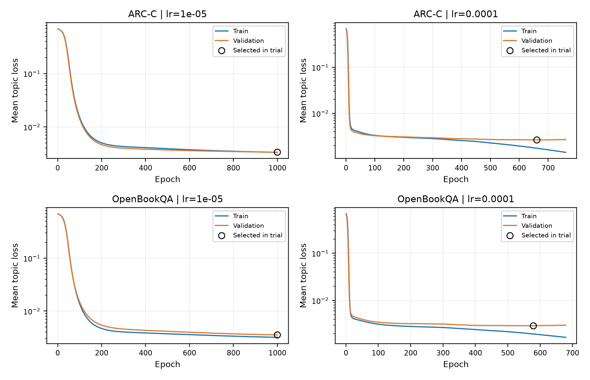

# TopicK 实验报告

报告日期：2026年11月16日。实验完成日期：2026年11月16日。

本实验将 TopicK 作为 CoopES 稿件的示例选择基线，核查本地实验配置的可行性。报告覆盖 ARC-C 与 OpenBookQA、Qwen2.5-7B Base 与 Llama-3-8B-Instruct 的四组结果；列出同一冻结评测协议下的 CoopES-R 重实现对照，并另列原稿第3页 Table I 外部参考。

训练对象为两套小型主题预测器，每个数据集一套、两个 Reader 共享；大语言模型及文本编码器均冻结。核心主题使用本地 Llama 标注，替代原方法的 GPT-4o，每任务300条训练来源题；这是一份经批准的适配实验，未调用付费API。正式结果采用完成一次收敛修复后的 run02，首轮 run01 全部保留。

## 1. 实验设置

### 1.1 数据集介绍

#### 1.1.1 ARC-C

ARC-C 为 AI2 Reasoning Challenge 的 Challenge 子集，是英语学校科学四选问答。输入为题干及选项，输出为正确选项位置。官方 train、validation、test 分别为1119、299、1172题。训练来源排除2条非四选项或答案映射无效记录，再去除1条内容重复，得到1116条。

最终评测从官方 test 中的1165条合格四选题冻结500题；没有用 TopicK 重抽测试集。样例（官方 test ID：Mercury_412463）：

```text
There are a total of eight planets that orbit the Sun. How many of the other planets orbit in the same direction as Earth?

A. 0
B. 1
C. 4
D. 7

正确答案：D
```

#### 1.1.2 OpenBookQA

OpenBookQA 是英语科学常识四选问答，本次使用 additional 配置。官方 train、validation、test 分别为4957、500、500题；训练来源去除5条重复内容，得到4952条。最终测试为全部500道官方 test 题，所有示例和待答题均保留 fact1，规范化为 fact。

本次OpenBookQA属于提供目标题gold fact1的oracle条件：fact1是与该题对应的正确支持事实。它不是答案位置标签，但提供了与不带事实问答不同的知识条件。原稿附录第6页Table IV同样出现{fact}字段，原作者运行时如何使用该字段尚未取得证据，不能断言原稿未使用事实。

样例（官方 test ID：970）：

```text
Fact: cooking food requires adding heat energy

Cooking peas requires

A. fresh briny sea water
B. an unheated stove top
C. salt and cayenne pepper
D. turning on a stove top

正确答案：D
```

| 数据集 | 官方训练 | 官方验证 | 官方测试 | 训练合格唯一题 | 最终测试 |
| --- | --- | --- | --- | --- | --- |
| ARC-C | 1119 | 299 | 1172 | 1116 | 500 |
| OpenBookQA | 4957 | 500 | 500 | 4952 | 500 |

| 数据用途 | 来源与抽样规则 | 数量/任务 | 用于训练/选模 |
| --- | --- | --- | --- |
| 主题监督源题 | 官方train；含冻结pool50，按官方ID哈希补足300 | 300 | 提供主题监督 |
| 内部训练/验证 | 300条查询级9:1固定划分 | 270 / 30 | 训练 / 选checkpoint |
| 最终候选池 | 既有冻结train清单 | 50 | 每题只从此选4条 |
| 开发集dev | 既有冻结官方validation清单 | 50 | 选择λ与端到端检查 |
| 正式评测 | 既有冻结官方test清单 | 500 | 预测后评分；不选模 |

270/30的分母为本方法的300条主题监督源题，不是官方 split 比例。训练、内部验证、最终候选、dev及test分别保存ID；训练与内部验证内容无交集，训练来源与dev/test内容无交集。标签0/1/2/3对应A/B/C/D，类别代表答案位置。

官方train/validation/test比例：ARC-C为1119:299:1172（分母2590），OpenBookQA为4957:500:500（分母5957）。本次主题监督源题/dev/test为300:50:500，三者不重叠；内部270/30仅分割这300条监督源题，不能将其内部验证30条与选λ的dev50混为一组。候选池50包含在监督源题300中，不重复计入独立题量。

### 1.2 模型介绍

| 角色 | 模型与结构 | 训练状态/用途 |
| --- | --- | --- |
| 文本编码器 | all-mpnet-base-v2；768维，mean pooling后L2归一化；最大384 token | 冻结FP32；编码题目及主题 |
| 主题预测器 | 3个Linear(768,768)，前两层ReLU；乘固定主题名称嵌入；1,771,776个训练参数 | 仅MLP训练FP32；每任务一套 |
| 主题标注模型 | 本地Llama-3-8B-Instruct | 冻结FP16；替代GPT-4o，标注600条源题 |
| 最终Reader | Qwen2.5-7B；28层、隐藏维度3584 | 冻结FP16；不量化 |
| 最终Reader | Llama3-8B-Instruct；32层、隐藏维度4096 | 冻结FP16；不量化 |

Qwen实际制品为项目冻结的Qwen2.5-7B base权重，不因存在chat template改称Instruct。Llama使用恢复后且11份参考文件均匹配的Instruct制品；服务器原有不同Llama权重保留未改。两个Reader均使用各自保存的原生聊天模板。与既有冻结评测的模型指纹一致，但尚未取得CoopES原实验的权重revision或指纹，不能据模型简称确认原稿也完全一致。

四组Reader主题知识向量分别计算，每组300次训练来源题的零样本答题；共享主题预测器不等于共享Reader知识。冻结reader路径、11份模型文件指纹及编码器权重指纹见证据索引。

### 1.3 评估指标

主指标为Accuracy，同时报告Weighted-F1与Macro-F1。N为测试题数，y与预测值分别为真实和预测选项；TP、FP、FN为每类真阳性、假阳性、假阴性，n为该类真实支持数。所有指标展示为百分数。

$\mathrm{Accuracy}=\frac{1}{N}\sum_{i=1}^{N}\mathbf{1}[\hat{y}_i=y_i]$

$F1_c=\frac{2TP_c}{2TP_c+FP_c+FN_c}$

$\mathrm{WeightedF1}=\sum_{c\in\{A,B,C,D\}}\frac{n_c}{N}F1_c,\quad\mathrm{MacroF1}=\frac{1}{4}\sum_{c\in\{A,B,C,D\}}F1_c$

F1分母为0时取0，Macro-F1始终对A/B/C/D四类平均。所有组均从500条逐题预测独立重算，并检查完整唯一ID、正确题数及混淆矩阵。主题验证损失和核心主题Recall@10用于模型选择/学习诊断，与最终答题准确率分开统计。单次seed=42，没有多种子均值、误差带或显著性结论。

### 1.4 参数设置

#### 1.4.1 主题标注与主题预测器训练

| 参数 | 实际设置 |
| --- | --- |
| 主题源题/划分 | 每任务300条；内部训练270、验证30；共600条标注 |
| 起始主题/候选主题 | 作者公开CMS词表3781个；BM25前10 + 去重后嵌入相似前10 |
| 标注设置 | Llama-3-8B-Instruct；确定性生成；首次max_new_tokens=128，格式不合格仅再试一次192；保存原始输入输出 |
| 架构/精度 | 三层768维MLP；1,771,776可训练参数；FP32；编码器及主题嵌入冻结 |
| 优化器 | AdamW；betas=(0.9,0.999)，eps=1e-8，weight_decay=0.01 |
| 实际batch/更新 | 64；梯度累积1；单GPU；drop_last=false；每轮ceil(270/64)=5步 |
| 学习率/调度 | 各任务比较1e-5和1e-4；恒定；warmup=0；无梯度裁剪、无dropout层 |
| run02训练预算 | 最多1000轮；至少50轮；验证损失连续100轮未改善则早停 |
| 选模规则 | 每轮验证；最小内部验证损失，平局取更早轮次，再取更小学习率 |
| 随机种子/恢复 | 训练和抽样seed=42；run02重新初始化MLP；复用原标注、嵌入与数据划分 |

| 数据集/学习率 | 停止轮次 | 采用轮次 | 实际更新数 | 采用轮更新数 |
| --- | --- | --- | --- | --- |
| ARC-C / 1e-05 | 1000 | 1000 | 5000 | 5000 |
| ARC-C / 0.0001 | 761 | 661 | 3805 | 3305 |
| OpenBookQA / 1e-05 | 1000 | 1000 | 5000 | 5000 |
| OpenBookQA / 0.0001 | 679 | 579 | 3395 | 2895 |

run02四个训练试验合计17,200次优化更新；最终两任务均选择lr=1e-4。ARC-C采用第661轮，OpenBookQA采用第579轮。停止轮次与采用检查点不同，停止前的100轮用于观察验证损失是否继续改善。

#### 1.4.2 最终检索与答题

| 参数 | 实际设置 |
| --- | --- |
| 候选池 / 示例数 | 每任务冻结50条 / 每题4条互异有序示例 |
| 检索选择 | 官方固定版TopicK逐步贪心选择；无beam；后续候选与已选嵌入均值合并预测集合主题 |
| 主题/语义权重 | 主题过滤分位数0.1；rank weight=0.53；知识clip[0.1,0.9]、分母+0.01；两类得分z-score |
| λ候选与选择 | 0.1、0.5、1.0；仅dev50准确率选取，平局取较小值 |
| Reader batch/精度/attention | 1 / FP16 / SDPA；无量化 |
| 最大输入/超长处理 | 3072 token；不截断，超长报错 |
| 答题方式 | 原生聊天模板，受约束一步生成A/B/C/D；规范token=32/33/34/35 |
| 生成设置 | max_new_tokens=1，do_sample=false，num_beams=1，repetition_penalty=1.0 |
| 采样参数 | 不采样，temperature/top_k/top_p的采样意义N/A；配置保留默认1.0/50/1.0 |
| 模板处理 | add_generation_prompt=True；编码add_special_tokens=False；共10条消息 |

### 1.5 硬软件环境

在既有AutoDL单卡容器中串行执行，n_gpu=1、world_size=1。下表来自运行/结束后环境记录；GPU进程峰值单独列在4.3，结束后的空闲显存不回填为训练峰值。

| 类别 | 实际配置 |
| --- | --- |
| GPU | NVIDIA GeForce RTX 4090；24,564 MiB |
| CPU / 内存额度 | 容器CPU quota为25核；内存90 GiB；宿主可见224核不等于独占 |
| 系统/磁盘 | Linux 5.15.0-94-generic；glibc2.35；系统盘30 GB、数据盘50 GB |
| Python/环境 | 3.12.16；/root/autodl-tmp/envs/se_dpo/bin/python |
| PyTorch/CUDA/驱动 | torch 2.8.0+cu128；构建CUDA12.8；驱动595.71.05，支持CUDA13.2 |
| Transformers / Accelerate | 4.56.2 / 1.10.1 |
| Datasets / Tokenizers | 4.1.1 / 0.22.2 |
| NumPy / Scikit-learn | 2.3.3 / 1.7.2 |
| rank-bm25 / safetensors | 0.2.2 / 0.8.0 |
| 费用 | 未调用付费API；没有GPU账单或单价，不估算实付金额 |

## 2. 训练方法

### 2.1 主题监督与覆盖选择

TopicK的核心思想是先判断问题涉及哪些主题，再结合Reader掌握这些主题的程度选择示例，使四条示例共同提供更有帮助的主题覆盖。语义相近的示例可能重复覆盖同一主题，故逐步选择时还要考虑已选集合，而非只取四条最相似题。

本次从作者CMS预定义主题表起步，为每条带答案的官方训练题检索20个候选主题，由冻结的本地Llama选择或补充至少5个核心主题。新增名称加入任务词表；最终ARC-C为3976个主题，OpenBookQA为3952个。使用该训练题与100个嵌入最近的其他训练题计算区分性权重，在核心主题内部按最大值归一化为软标签；其余主题标签为0。

编码器预先生成题目向量h与主题名称向量e，仅更新MLP参数θ。设B为训练batch、T为主题数，软标签为y，损失使用论文式(4)的字面实现：

$p_{jt}=\sigma(e_t^{\mathsf{T}}f_{\theta}(h_j))$

$\mathcal{L}=-\frac{1}{B|T|}\sum_{j=1}^{B}\sum_{t\in T}\left[y_{jt}\log p_{jt}+\mathbf{1}[y_{jt}=0]\log(1-p_{jt})\right]$

核心主题项为软权重乘log(p)，非核心主题项为log(1-p)，按batch与主题维取均值。该实现不额外加入核心主题的(1-y)log(1-p)项；不能用常见完整软标签BCE替代后仍称公式相同。

每个Reader分别在300条训练来源题上零样本答题，以预测主题概率加权汇总答题正确率，得到四份Reader主题知识。知识评估采用冻结的受约束字母生成协议，属于相对原方法PPL评估的明确适配。随后按官方固定提交的TopicK代码联合主题分数、Reader知识与语义相似度，逐次选择4条示例。

本次遵循官方代码的query raw logits过滤/排名及集合嵌入预测行为，未自行补入代码未显式实现的论文式(7)主题向量相减。适配选择器在3个合成种子×3个λ共9组条件下与该版本官方search函数对照，四个有序索引完全一致。源码快照与哈希留存，不声称原文公式与作者代码每一处相同。

### 2.2 模型选择与最终答题

run是一次独立实验执行的编号。run01表示首轮：每个学习率仅训练30轮，内部验证核心主题Recall@10不足1%，说明主题预测器学习不足。run02表示经用户批准的一次收敛修复：标注、数据、架构、损失和学习率不变，放宽训练上限并按验证损失早停。这两个编号不是两个数据集、两个Reader，也不是用于计算均值的两个随机种子。

| 版本 | 主题训练设置 | 用途/采用依据 |
| --- | --- | --- |
| run01 首轮 | 每任务两种学习率，各30轮；总600次更新 | 完整保留作诊断，未作为最终TopicK结果 |
| run02 修复轮 | 最多1000轮，patience=100；实际17,200次更新 | 两任务通过训练前固定的学习诊断门槛后，重算知识、dev与四组测试 |

run02最低学习诊断门槛为训练集核心主题Recall@10≥10%、内部验证Recall@10≥5%，仅用于排查近似未学习的预测器，不是作者原文提出的合格标准。正式选checkpoint仍按最小内部验证主题损失。内部验证Recall@10达到ARC-C 29.18%、OpenBookQA 29.26%。

| 组合 | 选中λ | dev准确率：λ=0.1 / 0.5 / 1.0 |
| --- | --- | --- |
| Llama3-8B / OpenBookQA | 0.1 | 94.00% / 90.00% / 90.00% |
| Qwen2.5-7B / OpenBookQA | 1.0 | 90.00% / 90.00% / 92.00% |
| Llama3-8B / ARC-C | 0.5 | 78.00% / 82.00% / 82.00% |
| Qwen2.5-7B / ARC-C | 0.5 | 92.00% / 94.00% / 94.00% |

锁定模型及λ后，先完成500题的示例选择并保存清单，评分端随后才打开独立gold文件。最终输入依次为system、4组user/assistant示例、1条目标user；目标输入没有gold。系统指令为：

```text
Answer with exactly one letter: A, B, C or D.
```

每组完整实际10条消息、全部四条示例及顺序、事实字段、原生模板渲染文本均保存在完整Prompt附件。目标真值和模型预测另列在输入之外。run02采用依据是内部验证与学习有效性，不按两轮test最高分拼接结果；Llama ARC-C由run01的82.80%降至run02的82.40%，仍如实采用run02。

## 3. 训练样本构造

### 3.1 数据预处理与划分

先按原始choices.label将答案映射到有序选项位置，保留官方ID。用于去重的内容键为NFKC及空白规范化的题干与有序选项，训练/内部验证及监督源题/冻结dev、test的内容交集均为空。OpenBookQA的fact1是协议允许的gold支持事实，所有示例和目标题都保留，报告按oracle条件解释。

每任务先保留冻结pool50，再按SHA256([42, task, "topick_topic_train", official_id])排序补至300条；按SHA256([42, task, "topic_internal_split", official_id])排序取30条内部验证，其余270条训练。内容键用于去重，实际排序键是官方ID；早期方案“内容哈希”的非精确表述已在执行记录中更正。

| 数据单位 | 每任务 | 总计/说明 |
| --- | --- | --- |
| 主题标注源题 | 300 | 两任务600条；run02全部复用 |
| MLP训练/内部验证 | 270 / 30 | 540 / 60独立题 |
| MLP训练试验 | 2 | 两任务共4个学习率试验 |
| Reader知识估计 | 每Reader 300 | 4组共1200次零样本答题 |
| dev参数比较 | 3λ×50×2Reader | 两任务共600次答题 |
| 正式测试 | 500×2Reader | 两任务共2000次答题 |

### 3.2 样本实例

ARC-C真实主题监督样例，官方train ID=Mercury_7107380，属于内部训练集：

```text
Students watched a bird fly to and from a large bush every few minutes. The students told their teacher, "The bird has a nest in that bush." This statement is an example of

A. an inference made from observations.
B. an observation made from predictions.
C. a prediction made from data samples.
D. a result made from inference.

正确答案：A
```

| 项目 | 实际内容 |
| --- | --- |
| 本地模型核心主题 | inference, observation, prediction, evidence, scientific knowledge, conclusion, assumption, investigation |
| 软标签（主题=权重） | conclusion=0.00022, evidence=0.00022, investigation=0.00002, scientific knowledge=0.00008, inference=1.00000, observation=0.00757, prediction=0.07789, assumption=0.00066 |
| 负主题与训练单位 | 未列为核心主题的标签为0；每条训练样本是一道题的主题标签向量，不展开DPO偏好对 |

OpenBookQA真实主题监督样例，官方train ID=13-783，属于内部训练集：

```text
Fact: a prism refracts light

What do you need to see a rainbow?

A. water
B. sea monsters
C. bats
D. leprechauns

正确答案：A
```

| 项目 | 实际内容 |
| --- | --- |
| 本地模型核心主题 | rainbow, sunlight, water, illumination, clouds |
| 软标签（主题=权重） | clouds=0.00251, illumination=0.05520, rainbow=1.00000, sunlight=0.01153, water=0.22706 |
| 负主题与训练单位 | 未列为核心主题的标签为0；每条训练样本是一道题的主题标签向量，不展开DPO偏好对 |

### 3.3 最终评测数据冻结与保存位置

最终候选池、dev与test沿用既有冻结清单：官方train50、validation50、test500。没有按TopicK的训练结果重新抽样。原冻结规则为seed=42，对[seed, task, role, official_id]取SHA256排序并检查跨集合内容去重；八个pool/dev/queries/gold文件与源协议逐字节相同。

原协议SHA256：b2a3853f17c1f76de17f7fd9acf89c0b79848ab4841868160a3b47e098872ff6。哈希用于确认材料身份，不能单独证明原稿也使用这些题。

| 材料 | 当前工作区内实际位置 |
| --- | --- |
| 官方训练源文件 | experiment/topick_run01/staged_assets/{arc_c,openbookqa}_official_train.parquet |
| 正式训练题与划分 | experiment/topick_run02/training/<任务>/rows.json、split.json、manifest.json |
| 主题监督与训练产物 | 同目录annotations.jsonl、soft_targets.npy、topics.json、best_model.json及lr_*/history.json、best.pt |
| 冻结数据 | experiment/topick_run02/<任务>_pool.json、_dev.json、_queries.json、_gold.json |
| 逐题预测/示例ID | experiment/topick_run02/table_runs/<组>/result.json及selection.json |
| 完整实际Prompt | output/TopicK_Baseline/run02/完整Prompt附件.md及四份*_full_prompt.json |

本地工作区绝对路径：C:/Users/33792/Desktop/论文/Topic Coverage-based Demonstration Retrieval for In-Context Learning。本表相对路径均从此目录起；逐项文件清单见output/TopicK_Baseline/run02/local_backup_manifest.json。

远端run02目录为/root/autodl-tmp/baseline_runs/topick/20261116_run02；大Reader与编码器完整权重仅在服务器，训练后的主题预测器权重已同步本地。

<!-- pagebreak -->

## 4. 实验结果及分析

### 4.1 测试结果与CoopES对照

正式结果统一采用run02。下表Acc、Weighted-F1、Macro-F1均由500题预测重算，采用λ是每组在dev50选中的固定值；未选中的λ没有对应test结果。Llama简称均指本次Llama-3-8B-Instruct，Qwen指Qwen2.5-7B Base。OpenBookQA所有行均提供目标gold fact1。

| 数据集 | Reader | 采用λ | 正确/总数 | Acc % | Weighted-F1 % | Macro-F1 % |
| --- | --- | --- | --- | --- | --- | --- |
| OpenBookQA | Llama3-8B | 0.1 | 449/500 | 89.80 | 89.8020 | 89.6337 |
| OpenBookQA | Qwen2.5-7B | 1.0 | 459/500 | 91.80 | 91.9177 | 91.6645 |
| ARC-C | Llama3-8B | 0.5 | 412/500 | 82.40 | 82.3859 | 82.4368 |
| ARC-C | Qwen2.5-7B | 0.5 | 440/500 | 88.00 | 87.9937 | 88.0882 |

#### 4.1.1 同一冻结评测协议下的CoopES-R对照

CoopES-R是经批准的重实现：全局贡献、dev50准确率效用、均匀权重、M=50，固定全局4条示例。双方共用候选池50、同一test500、精确Reader制品、事实字段、模板及受约束一字母解码。TopicK使用额外300题离线主题监督并在dev选择λ；CoopES-R用dev估计贡献。学习目标、离线信息与计算预算不同，均需披露。该重实现不等同于作者未知的原实现。

| 数据集/Reader | CoopES-R正确/总数 | CoopES-R Acc % | CoopES-R Weighted-F1 % | CoopES-R Macro-F1 % | TopicK−R Acc/pp |
| --- | --- | --- | --- | --- | --- |
| OpenBookQA / Llama3-8B | 446/500 | 89.20 | 89.2153 | 89.0455 | +0.60 |
| OpenBookQA / Qwen2.5-7B | 464/500 | 92.80 | 92.8561 | 92.6477 | -1.00 |
| ARC-C / Llama3-8B | 410/500 | 82.00 | 81.9788 | 82.0499 | +0.40 |
| ARC-C / Qwen2.5-7B | 435/500 | 87.00 | 87.0253 | 87.0977 | +1.00 |

在本次固定测试集上，TopicK相对CoopES-R的Acc差依次为+0.60、−1.00、+0.40、+1.00个百分点（表内顺序）。本报告未增加多种子实验，也未据此作显著性或普遍优劣结论。CoopES-R四组总墙钟约36分44秒；它的计时和离线算法工作量不同于TopicK，不直接据流水线时间给出算法加速比。

#### 4.1.2 CoopES原稿Table I外部参考

下表CoopES列为用户指定原稿第3页Table I表值，TopicK列为本次run02。原稿精确测试ID、Reader权重/量化及实际推理输入尚未完全取得，差值不属于原作者实现的精确复现结论。

| 数据集 | Reader | TopicK Acc % | 原稿CoopES Acc % | TopicK Weighted-F1 % | 原稿CoopES Weighted-F1 % |
| --- | --- | --- | --- | --- | --- |
| OpenBookQA | Llama3-8B | 89.80 | 75.20 | 89.8020 | 75.3462 |
| OpenBookQA | Qwen2.5-7B | 91.80 | 87.60 | 91.9177 | 87.5913 |
| ARC-C | Llama3-8B | 82.40 | 82.00 | 82.3859 | 82.3391 |
| ARC-C | Qwen2.5-7B | 88.00 | 88.40 | 87.9937 | 88.4130 |

原稿Table I没有逐题预测、Macro-F1或混淆矩阵，不能反推。原稿正文部分分数与Table I存在冲突，均按用户指定Table I取值。原稿写50训练/500 validation，不能据题量相同认定与本次官方test相同。正文及附录虽有prompt和{fact}示意，但不构成全量实际输入的证据。

OpenBookQA差异排查发现：500道冻结题与官方additional/test的ID、题干、选项、fact及标签全部一致；pool/dev/test内容交集为0。固定同一CoopES-R示例做dev50诊断，提供目标fact时Qwen/Llama均92%，去掉目标fact而保留示例fact时分别84%/82%。这些是开发集诊断，不是TopicK新的测试结果，也不能解释原稿差距的全部原因。原稿附录含fact，故不能把差距简单归因于原稿没有fact。

报告附带保留24条原表结果并新增4条TopicK的来源标注排版草稿。它保留适配脚注，只是论文表格草稿；原稿PDF保持原样。

### 4.2 训练过程与模型选择

下图为两任务、两种学习率实际执行的逐轮训练/验证主题损失，纵轴为对数刻度。空心圆标记该学习率试验中最低验证损失；最终采用lr=1e-4的ARC-C第661轮、OpenBookQA第579轮。每条曲线只有一个随机种子，不含多种子误差区间。



| 数据集/学习率 | 采用轮次 | 最佳验证损失 | 停止轮次 | 停止轮验证损失 |
| --- | --- | --- | --- | --- |
| ARC-C / 1e-05 | 1000 | 0.00335463 | 1000 | 0.00335463 |
| ARC-C / 0.0001 | 661 | 0.00264574 | 761 | 0.00270356 |
| OpenBookQA / 1e-05 | 1000 | 0.00353339 | 1000 | 0.00353339 |
| OpenBookQA / 0.0001 | 579 | 0.00290713 | 679 | 0.00301633 |

检查点选择依据是内部验证损失，不是训练loss最低，也不是最终test准确率最高。两组lr=1e-4均在最佳轮次之后又执行100轮才早停。本次未额外使用最后一轮重测test，故不能声称最后一轮测试分数更低；学习诊断通过也不等于原方法已达到作者全量训练水平。

| 数据集 | run01训练R@10 | run01验证R@10 | run02训练R@10 | run02验证R@10 |
| --- | --- | --- | --- | --- |
| ARC-C | 0.57% | 0.48% | 44.65% | 29.18% |
| OpenBookQA | 0.87% | 0.67% | 33.68% | 29.26% |

R@10为模型前10个预测主题中覆盖该题核心主题的比例，再按题平均；核心主题是本地模型标注，并非人工真值。上表体现修复后主题学习改善，不能替代最终问答效果。

| 数据集 | Reader | run01 Acc % | run02 Acc % | run02−run01 pp |
| --- | --- | --- | --- | --- |
| OpenBookQA | Llama3-8B | 89.00 | 89.80 | +0.80 |
| OpenBookQA | Qwen2.5-7B | 90.00 | 91.80 | +1.80 |
| ARC-C | Llama3-8B | 82.80 | 82.40 | -0.40 |
| ARC-C | Qwen2.5-7B | 87.00 | 88.00 | +1.00 |

该两轮对照用于说明修复记录，不作独立重复实验或随机种子统计。run01及其不利结果、run02的Llama ARC-C下降全部保留；四组统一采用run02，不逐组合挑较高分。

### 4.3 运行耗时与输入检查

实验运行快的直接原因是：只训练约177万个参数的MLP，编码器和7B/8B Reader均冻结；每任务270题、每轮5次更新；最终每题只生成一个选项字母。run02复用首轮600条主题标注及已编码向量，未重新标注。四组评测仍为500题/组，并未因为耗时短缩减测试量。

| 执行编号 | 北京时间起止（2026-11-16） | 流水线墙钟 | 计时范围 |
| --- | --- | --- | --- |
| run01 | 19:13:35 - 19:20:41 | 425.15秒（7分5.2秒） | run01含标注、首轮训练及四组评测 |
| run02 | 19:36:01 - 19:41:08 | 307.14秒（5分7.1秒） | run02含修复训练、重新估计知识/dev及四组评测 |

两轮上述流水线墙钟相加为732.29秒（12分12.3秒）；这不是整个项目从准备到交付的总用时，也不是纯GPU核函数时间。不包含前置权重恢复、部分数据准备、网络失败、人工核查、两轮间等待、备份及报告生成。

| 前置/共享阶段 | 实测时间 | run02处理 |
| --- | --- | --- |
| Llama reader恢复 | 945.65秒（15分45.6秒） | 另计；不计入任一流水线墙钟 |
| 首次远端Hub访问失败 | 206.29秒（3分26.3秒） | 失败记录保留；随后传入本地下载数据 |
| 训练来源准备 | 4.51秒（0分4.5秒） | 复用；不重复运行 |
| 主题/编码器资源准备 | 30.18秒（0分30.2秒） | 复用；不重复运行 |
| 初始文本编码 | 3.23秒（0分3.2秒） | 复用；不重复运行 |
| 600条主题标注 | 202.06秒（3分22.1秒） | 包含于run01；run02复用 |
| 主题软标签构造 | 1.56秒（0分1.6秒） | 包含于run01；run02复用 |
| MLP训练 | run01 3.272秒；run02 91.744秒 | 分别包含于对应轮次；勿再次加总 |

| 组合 | 知识估计/s | dev选择/s | 500题检索/s | 500题答题/s | 最大输入token |
| --- | --- | --- | --- | --- | --- |
| Llama3-8B / OpenBookQA | 7.90 | 7.78 | 1.76 | 24.04 | 418 |
| Qwen2.5-7B / OpenBookQA | 7.40 | 7.62 | 1.73 | 23.57 | 439 |
| Llama3-8B / ARC-C | 7.99 | 8.95 | 1.75 | 27.96 | 592 |
| Qwen2.5-7B / ARC-C | 7.75 | 8.39 | 1.73 | 26.34 | 579 |

run02四组正式Reader答题阶段共101.906秒（约19.63题/秒），仅为已加载Reader后的这些阶段，不包含恢复权重及模型加载。两次Reader加载另记Qwen 18.792秒、Llama 18.188秒，已包含于run02总墙钟。各阶段含本阶段计算和保存，分阶段相加与总墙钟的差额含初始化、指纹验证及smoke等。

| 组合 | min / median / p95 / max token | 候选覆盖/50 | 峰值allocated / reserved GiB |
| --- | --- | --- | --- |
| Llama3-8B / OpenBookQA | 254 / 311.0 / 366 / 418 | 50 | 15.132 / 16.131 |
| Qwen2.5-7B / OpenBookQA | 246 / 307.0 / 371 / 439 | 49 | 14.334 / 14.369 |
| Llama3-8B / ARC-C | 226 / 392.5 / 477 / 592 | 50 | 15.132 / 16.131 |
| Qwen2.5-7B / ARC-C | 224 / 384.0 / 469 / 579 | 50 | 14.334 / 14.369 |

四组输入均低于3072 token，未触发超长或截断。显存为Reader进程中PyTorch累计峰值，同一Reader的后续组可能包含前组峰值；不当作各组独立NVML峰值。run01仅部分时段的资源监控仍留存，不冒称run02全流程GPU峰值。

#### 4.3.1 Token用量与原始Response

以下统计来自实际请求记录。输入token按各模型自身tokenizer记录的input_tokens相加，输出按generated_token_ids长度相加。包括角色、模板与示例，不是只计算目标问题。MLP和编码器不生成答案；编码器处理token总量未记录。

| 轮次 | 实际阶段 | 请求数 | 输入token合计 | 输出token合计 |
| --- | --- | --- | --- | --- |
| run01 | offline_annotation | 604 | 125,169 | 缺失 |
| run01 | pretraining_dev_smoke | 6 | 2,329 | 6 |
| run01 | knowledge | 1200 | 102,174 | 1,200 |
| run01 | dev_smoke | 12 | 4,555 | 12 |
| run01 | dev_grid | 600 | 222,974 | 600 |
| run01 | formal_test | 2000 | 734,374 | 2,000 |
| run02 | knowledge | 1200 | 102,174 | 1,200 |
| run02 | dev_smoke | 12 | 4,278 | 12 |
| run02 | dev_grid | 600 | 212,445 | 600 |
| run02 | formal_test | 2000 | 701,326 | 2,000 |

两轮有记录的LLM请求共8,234次，输入合计2,211,798 token；已保存token ID的输出共7,630 token。离线标注各尝试保存raw_output和输入长度，未保存生成序列的token ID，故全流程实际输出总量为缺失，不能把128/192的输出上限当作消耗。run02复用标注不重复计入；这也不是付费API账单或GPU算力计量。

每阶段、Reader/数据集、λ的明细见token_usage.csv/.json。正式测试每轮2000次请求，各生成2000个答案token。原始Response和四选项logits保留于两轮各四组result.json；开发集三种λ、smoke与知识估计输出也在结果包。离线标注的原始输出另存annotation_responses.json（不附训练题文本、软标签矩阵或权重）。

完整Prompt附件展示每组一条实际完整输入（10条消息，全部4示例），另含原生渲染文本及哈希；其目标gold放在模型输入之外。其余测试输入保存prompt哈希与示例顺序，可结合冻结ID清单和官方数据重建。没有保存为文本的每一次标注渲染串不冒称全部原样齐备。

### 4.4 结论与资料来源

本次两轮8组共4000条正式测试预测均通过核验；正式采用run02，四组Acc为89.80%、91.80%、82.40%、88.00%（表内顺序）。约177万参数的主题预测器已完成训练，Reader和编码器冻结；该配置在本地完成端到端流程。同协议CoopES-R与原稿外部表值分开列出，不能据单种子或外部汇总数宣布普遍优劣。300题监督、CMS词表、本地Llama标注、oracle fact1和受约束字母答题均限制对其他设置的外推。

资料来源与附件（实验材料的相对路径从当前TopicK工作区起；文献原件的绝对位置见标准版证据索引）：

| 证据 | 位置/用途 |
| --- | --- |
| 排版依据 | 用户指定20261112_标准实验报告.pdf；9页，四章结构 |
| CoopES对照依据 | 同级CoopES论文目录中的原稿PDF第3页Table I；仅该表值为主参照 |
| 实测与独立核算 | output/TopicK_Baseline/run02/metrics_summary.json、*_metrics_recomputed.json、evidence_index.json |
| 本修订版主对照 | output/TopicK_Baseline/CoopES对照_标准版/CoopES_TopicK_主对比.json与.csv |
| 完整Prompt/训练曲线 | output/TopicK_Baseline/run02/完整Prompt附件.md；本修订版目录的逐轮训练曲线.csv、figures/topic_training.svg |
| 原始日志/权重 | experiment/topick_run01与topick_run02；保留两轮timeline、history、best.pt、逐题预测 |
| 原表扩展草稿 | 本修订版目录TableI_原表加TopicK_参考排版.md与.tex；保留适配脚注，不改原论文PDF |

TopicK官方论文与固定版代码来源沿用先前已核查记录：https://aclanthology.org/2025.emnlp-main.1007/；https://github.com/WonbinKweon/TopicK_EMNLP2025；提交0d5d0ba727d7cd072f8dc328ceaaee9ee949d440。本次交付整理仅生成报告、结果包和代码仓库，未启动训练、未改动既有预测或实验参数。报告遵循用户《实验报告要记录的东西》及修订后的实验报告技能，输出到results/。
